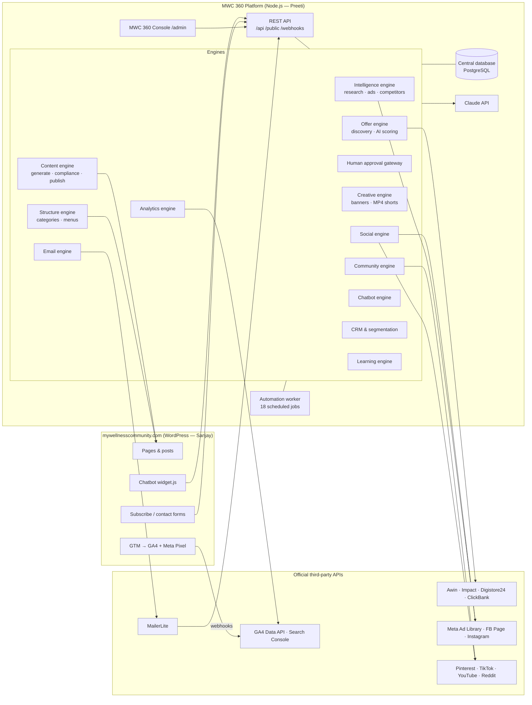
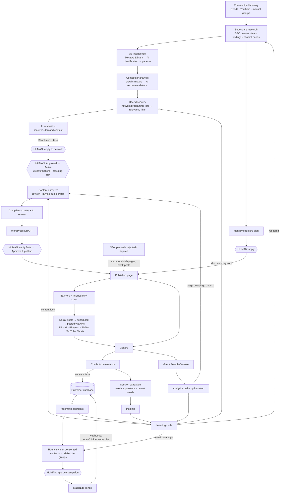
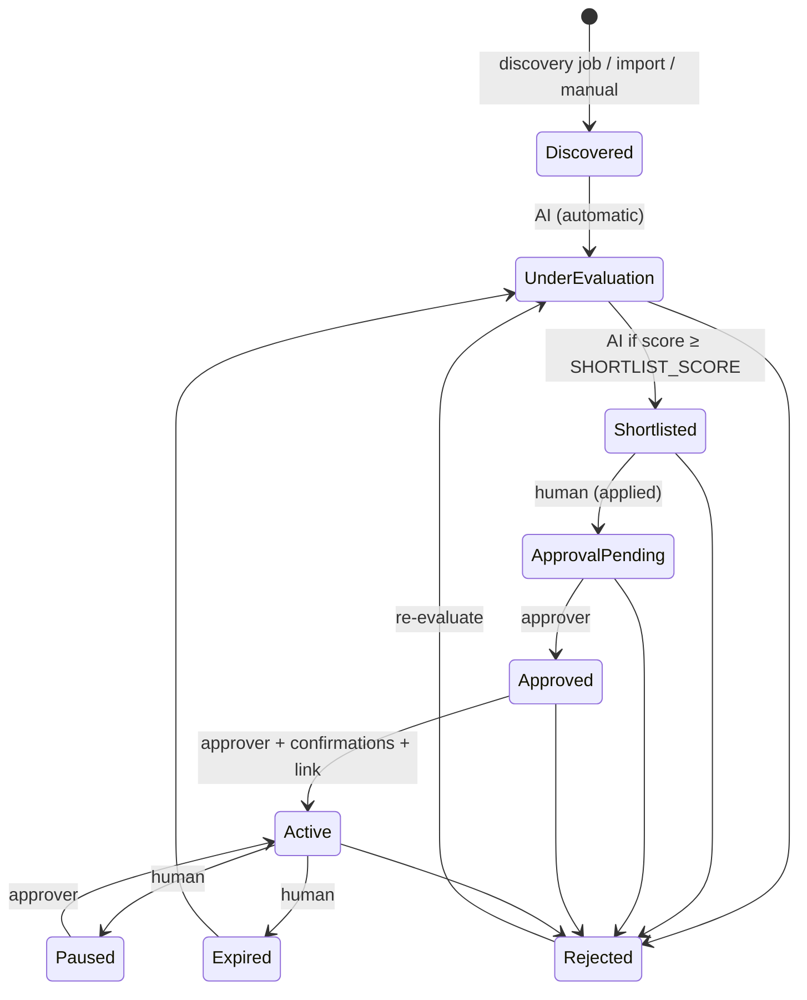

# Architecture

Deliverables 1, 3 and 4 from section 13 of the brief: the technical architecture diagram, the data flow and integration diagram, and the central database structure.

## 1. Technical architecture

**Processes.** `api` serves the console, the REST API, the public website endpoints and webhooks. `worker` runs the schedule in `src/jobs.js`. Both share one database. Small deployments can run both in one process (`RUN_SCHEDULER=true`).

**Extensibility.** A new affiliate network is one connector that returns the normalised offer shape (`src/connectors/affiliate.js`). A new social platform is one entry in the `publishers` registry (`src/connectors/social.js`). A different email provider replaces one file (`src/connectors/mailerlite.js`). None of these needs a database change, because business records are JSON documents with indexed status and key columns.

## 2. Data flow & feedback loops

## 3. Offer status machine (the approval gateway)

Only **Active** offers can be linked to content, mentioned by the chatbot, put in emails or posted on social media.

## 4. Central database

| Table | Purpose | Key fields (JSON body) |
|---|---|---|
| `research` | Secondary + primary research findings | title, category, vertical, market, finding, source, confidence |
| `ads` | Ads analysed (with source links) | brand, platform, format, hook, pain, trigger, story, cta, landing, source, runningDays |
| `competitors` | Competitor sites + crawl snapshots | name, url, features[], gaps, recommendations[], lastCrawl |
| `offers` | Central affiliate offer database | name, network, vertical, category, markets, commission, score, evaluation, status, activatedBy, affiliateLink |
| `content` | All website content | title, type, vertical, offerId, status, body, html, compliance, factsVerified, wpId, wpUrl |
| `creatives` | Banner sets, video scripts, creative briefs | contentId, copy, files{facebook,instagram,pinterest}, videoScript |
| `social` | Posts and their performance | platform, format, caption, link (UTM), imageUrl, date, status, reach, clicks |
| `contacts` | CRM: one record per person | email, name, country, vertical, interests[], needs, source, stage, engagement, consentEmail, suppressed, segments[], history[] |
| `interactions` | CRM interaction history | contactId, kind, text |
| `campaigns` | Email campaigns | name, type, segment, subject, body, status, mlId, sent, opens, clicks, unsubs |
| `metrics` | Analytics data points | date, source, page, query, sessions, clicks, conversions, revenue, position |
| `insights` | Learning engine | text, why, kind, module, priority, status, autoAction |
| `chats` | Chatbot sessions | turns[], summary, needs[], questions[], unmetNeeds[], contactId |
| `communities` | Social groups, subreddits, channels | name, platform, url, audience, activity, relevance, audienceNeeds, approach, rules, history[], growthPct |
| `plans` | AI site-structure proposals | plan{categories, menu, assignments, homepageSections, categoryPages}, diff, status, result |
| `platforms` | Affiliate access register (no secrets) | name, accountStatus, api, twoFA, vault |
| `phases` | Implementation phases | title, scope, acceptance, owner, status |
| `tasks` | Work queue for people | title, detail, module, ref, role, priority, status |
| `users` | Console/API users | name, role, token_hash |
| `audit` | Every approval, publish, consent change | at, actor, action, ref, detail |
| `job_runs` | Automation run log | job, started_at, finished_at, status, summary, error |
| `consent_log` | Proof of consent / withdrawal | email, action, consent_text, source, page, ip_hash, at |
| `suppression` | Never-email list | email, reason, at |
| `webhook_events` | Raw inbound events | source, type, payload |

Every document table has the columns `id, status, kind, ext_key, data (JSON), created_at, updated_at`.
